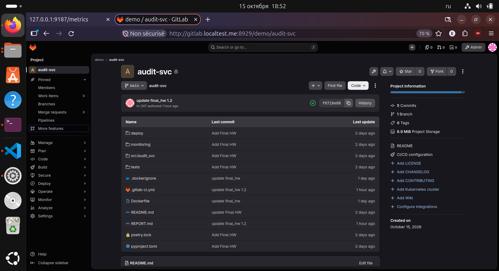
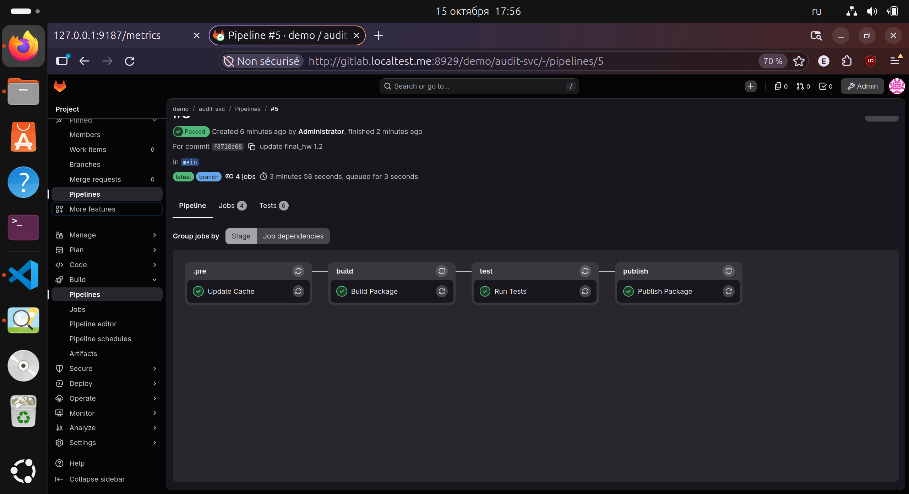
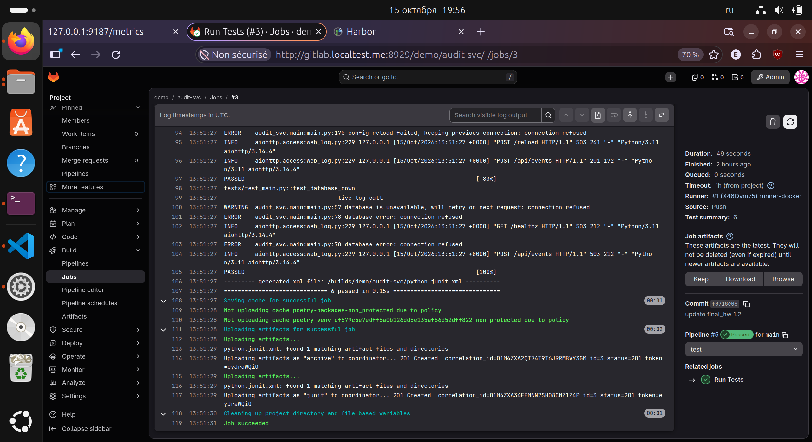
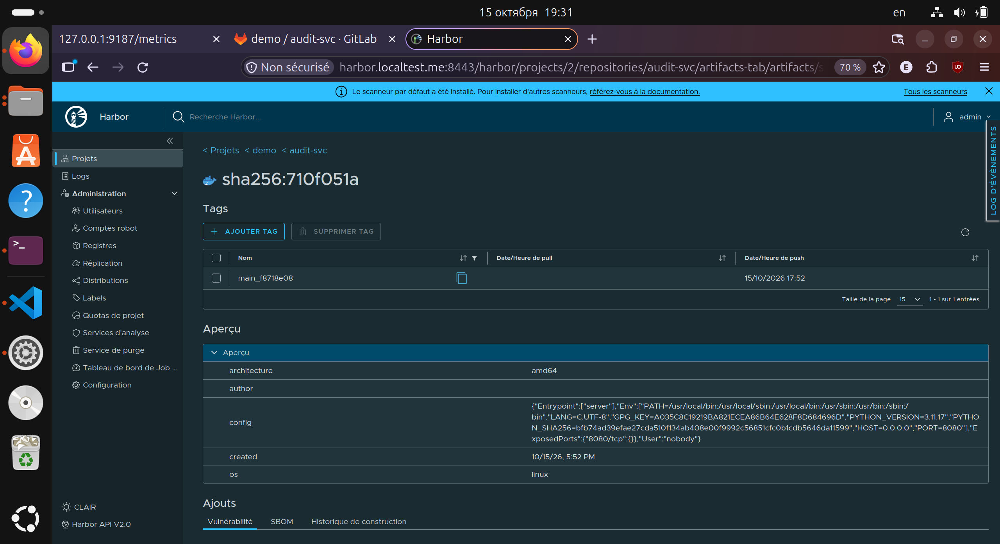
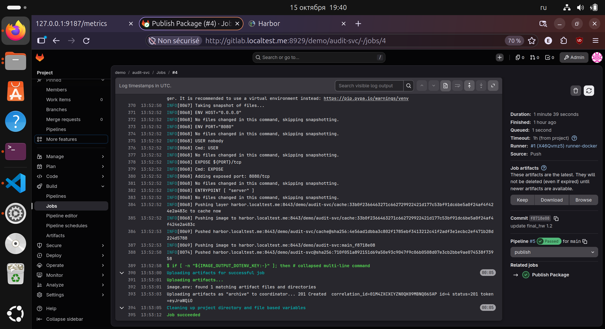
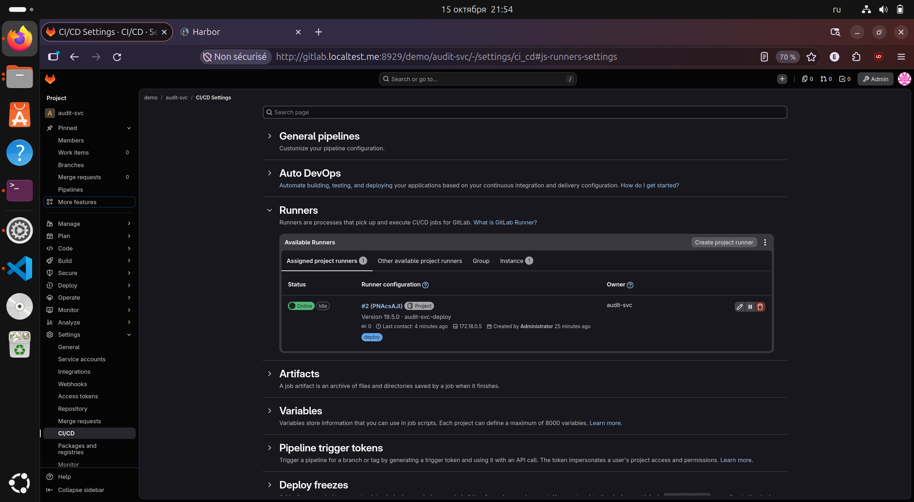
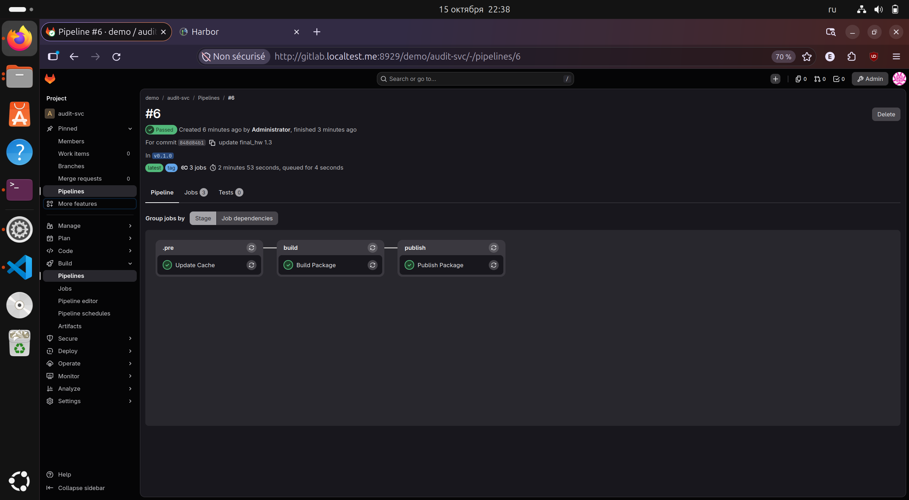
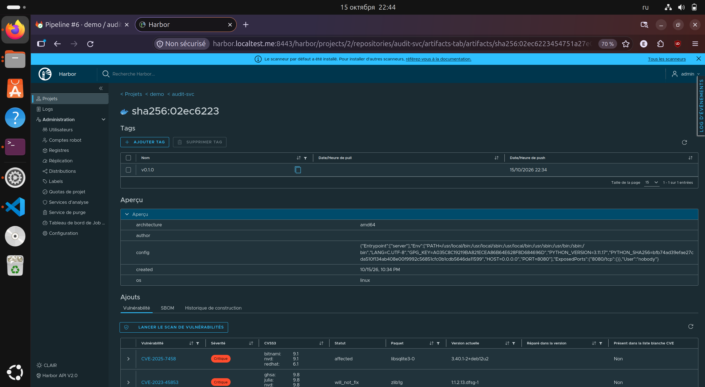

## Итоговая работа: развёртывание и мониторинг audit-svc

### 1. Сборка и публикация образа в CI
#### 1. Dockerfile
Проверим что Docker установлен
```
(.venv) (base) user@Ubuntu-desktop:~/vs_code/devops2_hw/audit_svc$ docker version
Client:
 Version:           29.1.3
 API version:       1.52
 Go version:        go1.24.13
 Git commit:        29.1.3-0ubuntu4.1
 Built:             Wed Apr 29 16:40:20 2026
 OS/Arch:           linux/amd64
 Context:           default
permission denied while trying to connect to the docker API at unix:///var/run/docker.sock
```

Настроим docker и добавим пользователя user в группу docker
```
(.venv) (base) user@Ubuntu-desktop:~/vs_code/devops2_hw/audit_svc$ sudo apt install -y util-linux-extra
Установка:                                                        
  util-linux-extra

Установка зависимостей:
  liblastlog2-2

Сводка:
  Обновление: 0, Установка: 2, Удаление: 0, Пропуск обновления: 76
  Объём загрузки: 374 kB
  Требуемое пространство: 1 407 kB / 19,8 GB доступно

Пол:1 http://ru.archive.ubuntu.com/ubuntu resolute-updates/main amd64 liblastlog2-2 amd64 2.41.3-3ubuntu2.2 [27,4 kB]
Пол:2 http://ru.archive.ubuntu.com/ubuntu resolute-updates/main amd64 util-linux-extra amd64 2.41.3-3ubuntu2.2 [347 kB]
Получено 374 kB за 1с (332 kB/s)            
Выбор ранее не выбранного пакета liblastlog2-2:amd64.
(Чтение базы данных … на данный момент установлено 265011 файлов и каталогов.)
Подготовка к распаковке …/liblastlog2-2_2.41.3-3ubuntu2.2_amd64.deb …
Распаковывается liblastlog2-2:amd64 (2.41.3-3ubuntu2.2) …
Выбор ранее не выбранного пакета util-linux-extra.
Подготовка к распаковке …/util-linux-extra_2.41.3-3ubuntu2.2_amd64.deb …
Распаковывается util-linux-extra (2.41.3-3ubuntu2.2) …
Настраивается пакет liblastlog2-2:amd64 (2.41.3-3ubuntu2.2) …
Настраивается пакет util-linux-extra (2.41.3-3ubuntu2.2) …
Обрабатываются триггеры для man-db (2.13.1-1build1) …
Обрабатываются триггеры для libc-bin (2.43-2ubuntu2.4) …
(.venv) (base) user@Ubuntu-desktop:~/vs_code/devops2_hw/audit_svc$ sudo usermod -aG docker user
(.venv) (base) user@Ubuntu-desktop:~/vs_code/devops2_hw/audit_svc$ newgrp docker
```

Попробуем создать docker-образ приложения
```
(base) user@Ubuntu-desktop:~/vs_code/devops2_hw/audit_svc$ docker build -t audit-svc:local .
DEPRECATED: The legacy builder is deprecated and will be removed in a future release.
            Install the buildx component to build images with BuildKit:
            https://docs.docker.com/go/buildx/

Sending build context to Docker daemon  210.9kB
Step 1/17 : FROM python:3.11-slim-bookworm AS base
3.11-slim-bookworm: Pulling from library/python
f9b274ee4fbe: Pulling fs layer
da3de1e6d2c4: Pulling fs layer
f8852cf3b2aa: Pulling fs layer
7fd1ebe418b5: Pulling fs layer
d0d76f1f9c45: Download complete
f9b274ee4fbe: Download complete
8e82fecd7f2b: Download complete
f8852cf3b2aa: Download complete
da3de1e6d2c4: Download complete
7fd1ebe418b5: Download complete
7fd1ebe418b5: Pull complete
f8852cf3b2aa: Pull complete
da3de1e6d2c4: Pull complete
f9b274ee4fbe: Pull complete
Digest: sha256:0a310eeecf4e1f5a0743f9a6520c90c88d089c903ca5fd283f501e3a805f5f89
Status: Downloaded newer image for python:3.11-slim-bookworm
 ---> 0a310eeecf4e
Step 2/17 : FROM base AS build
 ---> 0a310eeecf4e
Step 3/17 : SHELL [ "/bin/sh", "-eu", "-c" ]
 ---> Running in b2c78a40fa35
 ---> Removed intermediate container b2c78a40fa35
 ---> 72019119308f
Step 4/17 : ENV PIP_DISABLE_PIP_VERSION_CHECK=1
 ---> Running in 24216fb4a764
 ---> Removed intermediate container 24216fb4a764
 ---> 86836798725b
Step 5/17 : RUN pip install --no-cache-dir 'poetry==2.5.1' 'poetry-plugin-export==1.10.0'
 ---> Running in 54f1aeac170e
Collecting poetry==2.5.1
  Downloading poetry-2.5.1-py3-none-any.whl.metadata (7.6 kB)
Collecting poetry-plugin-export==1.10.0
  Downloading poetry_plugin_export-1.10.0-py3-none-any.whl.metadata (3.6 kB)
Collecting build<2.0.0,>=1.2.1 (from poetry==2.5.1)
  Downloading build-1.6.1-py3-none-any.whl.metadata (5.6 kB)
Collecting cachecontrol<0.15.0,>=0.14.0 (from cachecontrol[filecache]<0.15.0,>=0.14.0->poetry==2.5.1)
  Downloading cachecontrol-0.14.4-py3-none-any.whl.metadata (3.1 kB)
Collecting cleo<3.0.0,>=2.1.0 (from poetry==2.5.1)
  Downloading cleo-2.1.0-py3-none-any.whl.metadata (12 kB)
Collecting dulwich<2,>=0.25.0 (from poetry==2.5.1)
  Downloading dulwich-1.2.17-cp311-cp311-manylinux_2_28_x86_64.whl.metadata (6.0 kB)
Collecting fastjsonschema<3.0.0,>=2.18.0 (from poetry==2.5.1)
  Downloading fastjsonschema-2.22.2-py3-none-any.whl.metadata (2.1 kB)
Collecting findpython<0.9.0,>=0.6.2 (from poetry==2.5.1)
  Downloading findpython-0.8.0-py3-none-any.whl.metadata (5.4 kB)
Collecting installer<2.0.0,>=0.7.0 (from poetry==2.5.1)
  Downloading installer-1.1.0-py3-none-any.whl.metadata (1.3 kB)
Collecting keyring<26.0.0,>=25.1.0 (from poetry==2.5.1)
  Downloading keyring-25.7.0-py3-none-any.whl.metadata (21 kB)
Requirement already satisfied: packaging>=24.2 in /usr/local/lib/python3.11/site-packages (from poetry==2.5.1) (26.3)
Collecting pbs-installer>=2025.6.10 (from pbs-installer[download,install]>=2025.6.10->poetry==2.5.1)
  Downloading pbs_installer-2026.10.3-py3-none-any.whl.metadata (1.2 kB)
Collecting pkginfo<2.0,>=1.12 (from poetry==2.5.1)
  Downloading pkginfo-1.13-py3-none-any.whl.metadata (13 kB)
Collecting platformdirs<5,>=3.0.0 (from poetry==2.5.1)
  Downloading platformdirs-4.13.0-py3-none-any.whl.metadata (5.5 kB)
Collecting poetry-core==2.5.0 (from poetry==2.5.1)
  Downloading poetry_core-2.5.0-py3-none-any.whl.metadata (3.8 kB)
Collecting pyproject-hooks<2.0.0,>=1.0.0 (from poetry==2.5.1)
  Downloading pyproject_hooks-1.3.3-py3-none-any.whl.metadata (1.3 kB)
Collecting requests<3.0,>=2.26 (from poetry==2.5.1)
  Downloading requests-2.34.2-py3-none-any.whl.metadata (4.8 kB)
Collecting requests-toolbelt<2.0.0,>=1.0.0 (from poetry==2.5.1)
  Downloading requests_toolbelt-1.0.0-py2.py3-none-any.whl.metadata (14 kB)
Collecting shellingham<2.0,>=1.5 (from poetry==2.5.1)
  Downloading shellingham-1.5.4-py2.py3-none-any.whl.metadata (3.5 kB)
Collecting tomlkit<1.0.0,>=0.11.4 (from poetry==2.5.1)
  Downloading tomlkit-0.15.1-py3-none-any.whl.metadata (3.3 kB)
Collecting trove-classifiers>=2022.5.19 (from poetry==2.5.1)
  Downloading trove_classifiers-2026.9.21.13-py3-none-any.whl.metadata (2.4 kB)
Collecting virtualenv>=20.26.6 (from poetry==2.5.1)
  Downloading virtualenv-21.14.7-py3-none-any.whl.metadata (4.1 kB)
Collecting msgpack<2.0.0,>=0.5.2 (from cachecontrol<0.15.0,>=0.14.0->cachecontrol[filecache]<0.15.0,>=0.14.0->poetry==2.5.1)
  Downloading msgpack-1.2.3-cp311-cp311-manylinux2014_x86_64.manylinux_2_17_x86_64.manylinux_2_28_x86_64.whl.metadata (8.3 kB)
Collecting filelock>=3.8.0 (from cachecontrol[filecache]<0.15.0,>=0.14.0->poetry==2.5.1)
  Downloading filelock-4.1.1-py3-none-any.whl.metadata (2.0 kB)
Collecting crashtest<0.5.0,>=0.4.1 (from cleo<3.0.0,>=2.1.0->poetry==2.5.1)
  Downloading crashtest-0.4.1-py3-none-any.whl.metadata (1.1 kB)
Collecting rapidfuzz<4.0.0,>=3.0.0 (from cleo<3.0.0,>=2.1.0->poetry==2.5.1)
  Downloading rapidfuzz-3.14.6-cp311-cp311-manylinux_2_27_x86_64.manylinux_2_28_x86_64.whl.metadata (12 kB)
Collecting urllib3>=2.2.2 (from dulwich<2,>=0.25.0->poetry==2.5.1)
  Downloading urllib3-2.8.0-py3-none-any.whl.metadata (7.4 kB)
Collecting typing_extensions>=4.6.0 (from dulwich<2,>=0.25.0->poetry==2.5.1)
  Downloading typing_extensions-4.16.0-py3-none-any.whl.metadata (3.3 kB)
Collecting SecretStorage>=3.2 (from keyring<26.0.0,>=25.1.0->poetry==2.5.1)
  Downloading secretstorage-3.5.0-py3-none-any.whl.metadata (4.0 kB)
Collecting jeepney>=0.4.2 (from keyring<26.0.0,>=25.1.0->poetry==2.5.1)
  Downloading jeepney-0.9.0-py3-none-any.whl.metadata (1.2 kB)
Collecting importlib_metadata>=4.11.4 (from keyring<26.0.0,>=25.1.0->poetry==2.5.1)
  Downloading importlib_metadata-9.0.1-py3-none-any.whl.metadata (4.5 kB)
Collecting jaraco.classes (from keyring<26.0.0,>=25.1.0->poetry==2.5.1)
  Downloading jaraco.classes-3.4.0-py3-none-any.whl.metadata (2.6 kB)
Collecting jaraco.functools (from keyring<26.0.0,>=25.1.0->poetry==2.5.1)
  Downloading jaraco_functools-4.6.0-py3-none-any.whl.metadata (2.9 kB)
Collecting jaraco.context (from keyring<26.0.0,>=25.1.0->poetry==2.5.1)
  Downloading jaraco_context-6.1.2-py3-none-any.whl.metadata (4.2 kB)
Collecting httpx<1,>=0.27.0 (from pbs-installer[download,install]>=2025.6.10->poetry==2.5.1)
  Downloading httpx-0.28.1-py3-none-any.whl.metadata (7.1 kB)
Collecting backports.zstd>=1.0.0 (from pbs-installer[download,install]>=2025.6.10->poetry==2.5.1)
  Downloading backports_zstd-1.8.0-cp311-cp311-manylinux2014_x86_64.manylinux_2_17_x86_64.manylinux_2_28_x86_64.whl.metadata (6.8 kB)
Collecting charset_normalizer<4,>=2 (from requests<3.0,>=2.26->poetry==2.5.1)
  Downloading charset_normalizer-3.5.2-cp311-cp311-manylinux2014_x86_64.manylinux_2_17_x86_64.manylinux_2_28_x86_64.whl.metadata (46 kB)
     ━━━━━━━━━━━━━━━━━━━━━━━━━━━━━━━━━━━━━━━ 46.4/46.4 kB 670.1 kB/s eta 0:00:00
Collecting idna<4,>=2.5 (from requests<3.0,>=2.26->poetry==2.5.1)
  Downloading idna-3.20-py3-none-any.whl.metadata (7.2 kB)
Collecting certifi>=2023.5.7 (from requests<3.0,>=2.26->poetry==2.5.1)
  Downloading certifi-2026.7.22-py3-none-any.whl.metadata (2.5 kB)
Collecting distlib<1,>=0.4.3 (from virtualenv>=20.26.6->poetry==2.5.1)
  Downloading distlib-0.4.3-py2.py3-none-any.whl.metadata (5.3 kB)
Collecting python-discovery>=1.6.1 (from virtualenv>=20.26.6->poetry==2.5.1)
  Downloading python_discovery-1.6.2-py3-none-any.whl.metadata (5.1 kB)
Collecting anyio (from httpx<1,>=0.27.0->pbs-installer[download,install]>=2025.6.10->poetry==2.5.1)
  Downloading anyio-4.15.1-py3-none-any.whl.metadata (4.7 kB)
Collecting httpcore==1.* (from httpx<1,>=0.27.0->pbs-installer[download,install]>=2025.6.10->poetry==2.5.1)
  Downloading httpcore-1.0.9-py3-none-any.whl.metadata (21 kB)
Collecting h11>=0.16 (from httpcore==1.*->httpx<1,>=0.27.0->pbs-installer[download,install]>=2025.6.10->poetry==2.5.1)
  Downloading h11-0.16.0-py3-none-any.whl.metadata (8.3 kB)
Collecting zipp>=3.20 (from importlib_metadata>=4.11.4->keyring<26.0.0,>=25.1.0->poetry==2.5.1)
  Downloading zipp-4.1.1-py3-none-any.whl.metadata (3.6 kB)
Collecting cryptography>=2.0 (from SecretStorage>=3.2->keyring<26.0.0,>=25.1.0->poetry==2.5.1)
  Downloading cryptography-50.0.2-cp311-abi3-manylinux_2_34_x86_64.whl.metadata (4.4 kB)
Collecting more-itertools (from jaraco.classes->keyring<26.0.0,>=25.1.0->poetry==2.5.1)
  Downloading more_itertools-11.2.0-py3-none-any.whl.metadata (42 kB)
     ━━━━━━━━━━━━━━━━━━━━━━━━━━━━━━━━━━━━━━━━ 42.7/42.7 kB 1.5 MB/s eta 0:00:00
Collecting backports.tarfile (from jaraco.context->keyring<26.0.0,>=25.1.0->poetry==2.5.1)
  Downloading backports.tarfile-1.2.0-py3-none-any.whl.metadata (2.0 kB)
Collecting cffi>=2.0.0 (from cryptography>=2.0->SecretStorage>=3.2->keyring<26.0.0,>=25.1.0->poetry==2.5.1)
  Downloading cffi-2.1.1-cp311-cp311-manylinux2014_x86_64.manylinux_2_17_x86_64.whl.metadata (2.5 kB)
Collecting pycparser (from cffi>=2.0.0->cryptography>=2.0->SecretStorage>=3.2->keyring<26.0.0,>=25.1.0->poetry==2.5.1)
  Downloading pycparser-3.11-py3-none-any.whl.metadata (8.2 kB)
Downloading poetry-2.5.1-py3-none-any.whl (307 kB)
   ━━━━━━━━━━━━━━━━━━━━━━━━━━━━━━━━━━━━━━━ 307.6/307.6 kB 940.4 kB/s eta 0:00:00
Downloading poetry_plugin_export-1.10.0-py3-none-any.whl (13 kB)
Downloading poetry_core-2.5.0-py3-none-any.whl (413 kB)
   ━━━━━━━━━━━━━━━━━━━━━━━━━━━━━━━━━━━━━━━━ 413.6/413.6 kB 2.5 MB/s eta 0:00:00
Downloading build-1.6.1-py3-none-any.whl (31 kB)
Downloading cachecontrol-0.14.4-py3-none-any.whl (22 kB)
Downloading cleo-2.1.0-py3-none-any.whl (78 kB)
   ━━━━━━━━━━━━━━━━━━━━━━━━━━━━━━━━━━━━━━━━ 78.7/78.7 kB 71.4 MB/s eta 0:00:00
Downloading dulwich-1.2.17-cp311-cp311-manylinux_2_28_x86_64.whl (1.5 MB)
   ━━━━━━━━━━━━━━━━━━━━━━━━━━━━━━━━━━━━━━━━ 1.5/1.5 MB 6.8 MB/s eta 0:00:00
Downloading fastjsonschema-2.22.2-py3-none-any.whl (27 kB)
Downloading findpython-0.8.0-py3-none-any.whl (21 kB)
Downloading installer-1.1.0-py3-none-any.whl (464 kB)
   ━━━━━━━━━━━━━━━━━━━━━━━━━━━━━━━━━━━━━━━━ 464.5/464.5 kB 13.4 MB/s eta 0:00:00
Downloading keyring-25.7.0-py3-none-any.whl (39 kB)
Downloading pbs_installer-2026.10.3-py3-none-any.whl (83 kB)
   ━━━━━━━━━━━━━━━━━━━━━━━━━━━━━━━━━━━━━━━━ 83.0/83.0 kB 19.1 MB/s eta 0:00:00
Downloading pkginfo-1.13-py3-none-any.whl (32 kB)
Downloading platformdirs-4.13.0-py3-none-any.whl (32 kB)
Downloading pyproject_hooks-1.3.3-py3-none-any.whl (10 kB)
Downloading requests-2.34.2-py3-none-any.whl (73 kB)
   ━━━━━━━━━━━━━━━━━━━━━━━━━━━━━━━━━━━━━━━━ 73.1/73.1 kB 12.2 MB/s eta 0:00:00
Downloading requests_toolbelt-1.0.0-py2.py3-none-any.whl (54 kB)
   ━━━━━━━━━━━━━━━━━━━━━━━━━━━━━━━━━━━━━━━━ 54.5/54.5 kB 15.4 MB/s eta 0:00:00
Downloading shellingham-1.5.4-py2.py3-none-any.whl (9.8 kB)
Downloading tomlkit-0.15.1-py3-none-any.whl (49 kB)
   ━━━━━━━━━━━━━━━━━━━━━━━━━━━━━━━━━━━━━━━━ 49.4/49.4 kB 191.7 MB/s eta 0:00:00
Downloading trove_classifiers-2026.9.21.13-py3-none-any.whl (14 kB)
Downloading virtualenv-21.14.7-py3-none-any.whl (5.5 MB)
   ━━━━━━━━━━━━━━━━━━━━━━━━━━━━━━━━━━━━━━━━ 5.5/5.5 MB 7.1 MB/s eta 0:00:00
Downloading backports_zstd-1.8.0-cp311-cp311-manylinux2014_x86_64.manylinux_2_17_x86_64.manylinux_2_28_x86_64.whl (493 kB)
   ━━━━━━━━━━━━━━━━━━━━━━━━━━━━━━━━━━━━━━━━ 493.8/493.8 kB 10.9 MB/s eta 0:00:00
Downloading certifi-2026.7.22-py3-none-any.whl (136 kB)
   ━━━━━━━━━━━━━━━━━━━━━━━━━━━━━━━━━━━━━━━━ 137.0/137.0 kB 18.4 MB/s eta 0:00:00
Downloading charset_normalizer-3.5.2-cp311-cp311-manylinux2014_x86_64.manylinux_2_17_x86_64.manylinux_2_28_x86_64.whl (269 kB)
   ━━━━━━━━━━━━━━━━━━━━━━━━━━━━━━━━━━━━━━━━ 270.0/270.0 kB 12.0 MB/s eta 0:00:00
Downloading crashtest-0.4.1-py3-none-any.whl (7.6 kB)
Downloading distlib-0.4.3-py2.py3-none-any.whl (470 kB)
   ━━━━━━━━━━━━━━━━━━━━━━━━━━━━━━━━━━━━━━━━ 470.6/470.6 kB 18.0 MB/s eta 0:00:00
Downloading filelock-4.1.1-py3-none-any.whl (132 kB)
   ━━━━━━━━━━━━━━━━━━━━━━━━━━━━━━━━━━━━━━━ 132.5/132.5 kB 179.2 MB/s eta 0:00:00
Downloading httpx-0.28.1-py3-none-any.whl (73 kB)
   ━━━━━━━━━━━━━━━━━━━━━━━━━━━━━━━━━━━━━━━━ 73.5/73.5 kB 25.6 MB/s eta 0:00:00
Downloading httpcore-1.0.9-py3-none-any.whl (78 kB)
   ━━━━━━━━━━━━━━━━━━━━━━━━━━━━━━━━━━━━━━━━ 78.8/78.8 kB 168.1 MB/s eta 0:00:00
Downloading idna-3.20-py3-none-any.whl (69 kB)
   ━━━━━━━━━━━━━━━━━━━━━━━━━━━━━━━━━━━━━━━━ 69.6/69.6 kB 12.2 MB/s eta 0:00:00
Downloading importlib_metadata-9.0.1-py3-none-any.whl (27 kB)
Downloading jeepney-0.9.0-py3-none-any.whl (49 kB)
   ━━━━━━━━━━━━━━━━━━━━━━━━━━━━━━━━━━━━━━━━ 49.0/49.0 kB 188.0 MB/s eta 0:00:00
Downloading msgpack-1.2.3-cp311-cp311-manylinux2014_x86_64.manylinux_2_17_x86_64.manylinux_2_28_x86_64.whl (477 kB)
   ━━━━━━━━━━━━━━━━━━━━━━━━━━━━━━━━━━━━━━━━ 477.8/477.8 kB 14.9 MB/s eta 0:00:00
Downloading python_discovery-1.6.2-py3-none-any.whl (38 kB)
Downloading rapidfuzz-3.14.6-cp311-cp311-manylinux_2_27_x86_64.manylinux_2_28_x86_64.whl (3.2 MB)
   ━━━━━━━━━━━━━━━━━━━━━━━━━━━━━━━━━━━━━━━━ 3.2/3.2 MB 8.4 MB/s eta 0:00:00
Downloading secretstorage-3.5.0-py3-none-any.whl (15 kB)
Downloading typing_extensions-4.16.0-py3-none-any.whl (45 kB)
   ━━━━━━━━━━━━━━━━━━━━━━━━━━━━━━━━━━━━━━━━ 45.6/45.6 kB 33.7 MB/s eta 0:00:00
Downloading urllib3-2.8.0-py3-none-any.whl (135 kB)
   ━━━━━━━━━━━━━━━━━━━━━━━━━━━━━━━━━━━━━━━━ 135.7/135.7 kB 19.2 MB/s eta 0:00:00
Downloading jaraco.classes-3.4.0-py3-none-any.whl (6.8 kB)
Downloading jaraco_context-6.1.2-py3-none-any.whl (7.9 kB)
Downloading jaraco_functools-4.6.0-py3-none-any.whl (11 kB)
Downloading cryptography-50.0.2-cp311-abi3-manylinux_2_34_x86_64.whl (4.8 MB)
   ━━━━━━━━━━━━━━━━━━━━━━━━━━━━━━━━━━━━━━━━ 4.8/4.8 MB 7.3 MB/s eta 0:00:00
Downloading zipp-4.1.1-py3-none-any.whl (10 kB)
Downloading anyio-4.15.1-py3-none-any.whl (132 kB)
   ━━━━━━━━━━━━━━━━━━━━━━━━━━━━━━━━━━━━━━━━ 132.1/132.1 kB 10.2 MB/s eta 0:00:00
Downloading backports.tarfile-1.2.0-py3-none-any.whl (30 kB)
Downloading more_itertools-11.2.0-py3-none-any.whl (74 kB)
   ━━━━━━━━━━━━━━━━━━━━━━━━━━━━━━━━━━━━━━━━ 74.4/74.4 kB 7.5 MB/s eta 0:00:00
Downloading cffi-2.1.1-cp311-cp311-manylinux2014_x86_64.manylinux_2_17_x86_64.whl (217 kB)
   ━━━━━━━━━━━━━━━━━━━━━━━━━━━━━━━━━━━━━━━━ 217.8/217.8 kB 16.0 MB/s eta 0:00:00
Downloading h11-0.16.0-py3-none-any.whl (37 kB)
Downloading pycparser-3.11-py3-none-any.whl (51 kB)
   ━━━━━━━━━━━━━━━━━━━━━━━━━━━━━━━━━━━━━━━━ 51.2/51.2 kB 76.1 MB/s eta 0:00:00
Installing collected packages: trove-classifiers, distlib, zipp, urllib3, typing_extensions, tomlkit, shellingham, rapidfuzz, pyproject-hooks, pycparser, poetry-core, platformdirs, pkginfo, pbs-installer, msgpack, more-itertools, jeepney, installer, idna, h11, filelock, fastjsonschema, crashtest, charset_normalizer, certifi, backports.zstd, backports.tarfile, requests, python-discovery, jaraco.functools, jaraco.context, jaraco.classes, importlib_metadata, httpcore, findpython, dulwich, cleo, cffi, build, anyio, virtualenv, requests-toolbelt, httpx, cryptography, cachecontrol, SecretStorage, keyring, poetry, poetry-plugin-export
Successfully installed SecretStorage-3.5.0 anyio-4.15.1 backports.tarfile-1.2.0 backports.zstd-1.8.0 build-1.6.1 cachecontrol-0.14.4 certifi-2026.7.22 cffi-2.1.1 charset_normalizer-3.5.2 cleo-2.1.0 crashtest-0.4.1 cryptography-50.0.2 distlib-0.4.3 dulwich-1.2.17 fastjsonschema-2.22.2 filelock-4.1.1 findpython-0.8.0 h11-0.16.0 httpcore-1.0.9 httpx-0.28.1 idna-3.20 importlib_metadata-9.0.1 installer-1.1.0 jaraco.classes-3.4.0 jaraco.context-6.1.2 jaraco.functools-4.6.0 jeepney-0.9.0 keyring-25.7.0 more-itertools-11.2.0 msgpack-1.2.3 pbs-installer-2026.10.3 pkginfo-1.13 platformdirs-4.13.0 poetry-2.5.1 poetry-core-2.5.0 poetry-plugin-export-1.10.0 pycparser-3.11 pyproject-hooks-1.3.3 python-discovery-1.6.2 rapidfuzz-3.14.6 requests-2.34.2 requests-toolbelt-1.0.0 shellingham-1.5.4 tomlkit-0.15.1 trove-classifiers-2026.9.21.13 typing_extensions-4.16.0 urllib3-2.8.0 virtualenv-21.14.7 zipp-4.1.1
WARNING: Running pip as the 'root' user can result in broken permissions and conflicting behaviour with the system package manager. It is recommended to use a virtual environment instead: https://pip.pypa.io/warnings/venv
 ---> Removed intermediate container 54f1aeac170e
 ---> b8403b694ac9
Step 6/17 : WORKDIR /build
 ---> Running in 27d8221db494
 ---> Removed intermediate container 27d8221db494
 ---> d6bdf7bb03d5
Step 7/17 : COPY pyproject.toml poetry.lock README.md ./
 ---> 6635b3120f41
Step 8/17 : COPY src/ src/
 ---> 740e8c82bc11
Step 9/17 : RUN   mkdir -p dist   && poetry export --without-hashes --format constraints.txt --output dist/constraints.txt   && pip wheel --no-cache-dir --isolated --requirement dist/constraints.txt --wheel-dir dist/vendor   && poetry build --format wheel
 ---> Running in 190cc24e780c
Collecting aiohappyeyeballs==2.7.1 (from -r dist/constraints.txt (line 1))
  Downloading aiohappyeyeballs-2.7.1-py3-none-any.whl.metadata (5.9 kB)
Collecting aiohttp==3.14.4 (from -r dist/constraints.txt (line 2))
  Downloading aiohttp-3.14.4-cp311-cp311-manylinux2014_x86_64.manylinux_2_17_x86_64.manylinux_2_28_x86_64.whl.metadata (8.3 kB)
Collecting aiosignal==1.4.0 (from -r dist/constraints.txt (line 3))
  Downloading aiosignal-1.4.0-py3-none-any.whl.metadata (3.7 kB)
Collecting asyncpg==0.30.0 (from -r dist/constraints.txt (line 4))
  Downloading asyncpg-0.30.0-cp311-cp311-manylinux_2_17_x86_64.manylinux2014_x86_64.whl.metadata (5.0 kB)
Collecting attrs==26.1.0 (from -r dist/constraints.txt (line 5))
  Downloading attrs-26.1.0-py3-none-any.whl.metadata (8.8 kB)
Collecting frozenlist==1.8.0 (from -r dist/constraints.txt (line 6))
  Downloading frozenlist-1.8.0-cp311-cp311-manylinux1_x86_64.manylinux_2_28_x86_64.manylinux_2_5_x86_64.whl.metadata (20 kB)
Collecting idna==3.20 (from -r dist/constraints.txt (line 7))
  Downloading idna-3.20-py3-none-any.whl.metadata (7.2 kB)
Collecting multidict==6.9.1 (from -r dist/constraints.txt (line 8))
  Downloading multidict-6.9.1-cp311-cp311-manylinux2014_x86_64.manylinux_2_17_x86_64.manylinux_2_28_x86_64.whl.metadata (5.3 kB)
Collecting prometheus-client==0.21.1 (from -r dist/constraints.txt (line 9))
  Downloading prometheus_client-0.21.1-py3-none-any.whl.metadata (1.8 kB)
Collecting propcache==0.5.4 (from -r dist/constraints.txt (line 10))
  Downloading propcache-0.5.4-cp311-cp311-manylinux2014_x86_64.manylinux_2_17_x86_64.manylinux_2_28_x86_64.whl.metadata (25 kB)
Collecting pyyaml==6.0.3 (from -r dist/constraints.txt (line 11))
  Downloading pyyaml-6.0.3-cp311-cp311-manylinux2014_x86_64.manylinux_2_17_x86_64.manylinux_2_28_x86_64.whl.metadata (2.4 kB)
Collecting typing-extensions==4.16.0 (from -r dist/constraints.txt (line 12))
  Downloading typing_extensions-4.16.0-py3-none-any.whl.metadata (3.3 kB)
Collecting yarl==1.25.1 (from -r dist/constraints.txt (line 13))
  Downloading yarl-1.25.1-cp311-cp311-manylinux2014_x86_64.manylinux_2_17_x86_64.manylinux_2_28_x86_64.whl.metadata (111 kB)
     ━━━━━━━━━━━━━━━━━━━━━━━━━━━━━━━━━━━━━ 111.6/111.6 kB 491.3 kB/s eta 0:00:00
Downloading aiohappyeyeballs-2.7.1-py3-none-any.whl (15 kB)
Downloading aiohttp-3.14.4-cp311-cp311-manylinux2014_x86_64.manylinux_2_17_x86_64.manylinux_2_28_x86_64.whl (1.9 MB)
   ━━━━━━━━━━━━━━━━━━━━━━━━━━━━━━━━━━━━━━━━ 1.9/1.9 MB 1.4 MB/s eta 0:00:00
Downloading aiosignal-1.4.0-py3-none-any.whl (7.5 kB)
Downloading asyncpg-0.30.0-cp311-cp311-manylinux_2_17_x86_64.manylinux2014_x86_64.whl (3.1 MB)
   ━━━━━━━━━━━━━━━━━━━━━━━━━━━━━━━━━━━━━━━━ 3.1/3.1 MB 2.1 MB/s eta 0:00:00
Downloading attrs-26.1.0-py3-none-any.whl (67 kB)
   ━━━━━━━━━━━━━━━━━━━━━━━━━━━━━━━━━━━━━━━━ 67.5/67.5 kB 4.0 MB/s eta 0:00:00
Downloading frozenlist-1.8.0-cp311-cp311-manylinux1_x86_64.manylinux_2_28_x86_64.manylinux_2_5_x86_64.whl (231 kB)
   ━━━━━━━━━━━━━━━━━━━━━━━━━━━━━━━━━━━━━━━━ 231.1/231.1 kB 3.3 MB/s eta 0:00:00
Downloading idna-3.20-py3-none-any.whl (69 kB)
   ━━━━━━━━━━━━━━━━━━━━━━━━━━━━━━━━━━━━━━━━ 69.6/69.6 kB 3.8 MB/s eta 0:00:00
Downloading multidict-6.9.1-cp311-cp311-manylinux2014_x86_64.manylinux_2_17_x86_64.manylinux_2_28_x86_64.whl (320 kB)
   ━━━━━━━━━━━━━━━━━━━━━━━━━━━━━━━━━━━━━━━━ 320.7/320.7 kB 3.5 MB/s eta 0:00:00
Downloading prometheus_client-0.21.1-py3-none-any.whl (54 kB)
   ━━━━━━━━━━━━━━━━━━━━━━━━━━━━━━━━━━━━━━━━ 54.7/54.7 kB 2.7 MB/s eta 0:00:00
Downloading propcache-0.5.4-cp311-cp311-manylinux2014_x86_64.manylinux_2_17_x86_64.manylinux_2_28_x86_64.whl (235 kB)
   ━━━━━━━━━━━━━━━━━━━━━━━━━━━━━━━━━━━━━━━━ 235.4/235.4 kB 3.4 MB/s eta 0:00:00
Downloading pyyaml-6.0.3-cp311-cp311-manylinux2014_x86_64.manylinux_2_17_x86_64.manylinux_2_28_x86_64.whl (806 kB)
   ━━━━━━━━━━━━━━━━━━━━━━━━━━━━━━━━━━━━━━━━ 806.6/806.6 kB 2.9 MB/s eta 0:00:00
Downloading typing_extensions-4.16.0-py3-none-any.whl (45 kB)
   ━━━━━━━━━━━━━━━━━━━━━━━━━━━━━━━━━━━━━━━━ 45.6/45.6 kB 4.6 MB/s eta 0:00:00
Downloading yarl-1.25.1-cp311-cp311-manylinux2014_x86_64.manylinux_2_17_x86_64.manylinux_2_28_x86_64.whl (117 kB)
   ━━━━━━━━━━━━━━━━━━━━━━━━━━━━━━━━━━━━━━━━ 117.7/117.7 kB 3.8 MB/s eta 0:00:00
Saved ./dist/vendor/aiohappyeyeballs-2.7.1-py3-none-any.whl
Saved ./dist/vendor/aiohttp-3.14.4-cp311-cp311-manylinux2014_x86_64.manylinux_2_17_x86_64.manylinux_2_28_x86_64.whl
Saved ./dist/vendor/aiosignal-1.4.0-py3-none-any.whl
Saved ./dist/vendor/asyncpg-0.30.0-cp311-cp311-manylinux_2_17_x86_64.manylinux2014_x86_64.whl
Saved ./dist/vendor/attrs-26.1.0-py3-none-any.whl
Saved ./dist/vendor/frozenlist-1.8.0-cp311-cp311-manylinux1_x86_64.manylinux_2_28_x86_64.manylinux_2_5_x86_64.whl
Saved ./dist/vendor/idna-3.20-py3-none-any.whl
Saved ./dist/vendor/multidict-6.9.1-cp311-cp311-manylinux2014_x86_64.manylinux_2_17_x86_64.manylinux_2_28_x86_64.whl
Saved ./dist/vendor/prometheus_client-0.21.1-py3-none-any.whl
Saved ./dist/vendor/propcache-0.5.4-cp311-cp311-manylinux2014_x86_64.manylinux_2_17_x86_64.manylinux_2_28_x86_64.whl
Saved ./dist/vendor/pyyaml-6.0.3-cp311-cp311-manylinux2014_x86_64.manylinux_2_17_x86_64.manylinux_2_28_x86_64.whl
Saved ./dist/vendor/typing_extensions-4.16.0-py3-none-any.whl
Saved ./dist/vendor/yarl-1.25.1-cp311-cp311-manylinux2014_x86_64.manylinux_2_17_x86_64.manylinux_2_28_x86_64.whl

[notice] A new release of pip is available: 24.0 -> 26.2.1
[notice] To update, run: pip install --upgrade pip
Creating virtualenv audit-svc-XDF0t07c-py3.11 in /root/.cache/pypoetry/virtualenvs
Building audit-svc (0.1.0)
Building wheel
  - Building wheel
  - Built audit_svc-0.1.0-py3-none-any.whl
 ---> Removed intermediate container 190cc24e780c
 ---> adabd075e117
Step 10/17 : FROM base AS final
 ---> 0a310eeecf4e
Step 11/17 : COPY --from=build /build/dist/ /tmp/dist/
 ---> f00640e028fa
Step 12/17 : RUN pip install --no-cache-dir --no-index --find-links /tmp/dist/vendor /tmp/dist/*.whl  && rm -rf /tmp/dist
 ---> Running in ccb07c1bb4de
Looking in links: /tmp/dist/vendor
Processing /tmp/dist/audit_svc-0.1.0-py3-none-any.whl
Processing /tmp/dist/vendor/aiohttp-3.14.4-cp311-cp311-manylinux2014_x86_64.manylinux_2_17_x86_64.manylinux_2_28_x86_64.whl (from audit-svc==0.1.0)
Processing /tmp/dist/vendor/asyncpg-0.30.0-cp311-cp311-manylinux_2_17_x86_64.manylinux2014_x86_64.whl (from audit-svc==0.1.0)
Processing /tmp/dist/vendor/prometheus_client-0.21.1-py3-none-any.whl (from audit-svc==0.1.0)
Processing /tmp/dist/vendor/pyyaml-6.0.3-cp311-cp311-manylinux2014_x86_64.manylinux_2_17_x86_64.manylinux_2_28_x86_64.whl (from audit-svc==0.1.0)
Processing /tmp/dist/vendor/aiohappyeyeballs-2.7.1-py3-none-any.whl (from aiohttp<4.0.0,>=3.9.5->audit-svc==0.1.0)
Processing /tmp/dist/vendor/aiosignal-1.4.0-py3-none-any.whl (from aiohttp<4.0.0,>=3.9.5->audit-svc==0.1.0)
Processing /tmp/dist/vendor/attrs-26.1.0-py3-none-any.whl (from aiohttp<4.0.0,>=3.9.5->audit-svc==0.1.0)
Processing /tmp/dist/vendor/frozenlist-1.8.0-cp311-cp311-manylinux1_x86_64.manylinux_2_28_x86_64.manylinux_2_5_x86_64.whl (from aiohttp<4.0.0,>=3.9.5->audit-svc==0.1.0)
Processing /tmp/dist/vendor/multidict-6.9.1-cp311-cp311-manylinux2014_x86_64.manylinux_2_17_x86_64.manylinux_2_28_x86_64.whl (from aiohttp<4.0.0,>=3.9.5->audit-svc==0.1.0)
Processing /tmp/dist/vendor/propcache-0.5.4-cp311-cp311-manylinux2014_x86_64.manylinux_2_17_x86_64.manylinux_2_28_x86_64.whl (from aiohttp<4.0.0,>=3.9.5->audit-svc==0.1.0)
Processing /tmp/dist/vendor/typing_extensions-4.16.0-py3-none-any.whl (from aiohttp<4.0.0,>=3.9.5->audit-svc==0.1.0)
Processing /tmp/dist/vendor/yarl-1.25.1-cp311-cp311-manylinux2014_x86_64.manylinux_2_17_x86_64.manylinux_2_28_x86_64.whl (from aiohttp<4.0.0,>=3.9.5->audit-svc==0.1.0)
Processing /tmp/dist/vendor/idna-3.20-py3-none-any.whl (from yarl<2.0,>=1.25.1->aiohttp<4.0.0,>=3.9.5->audit-svc==0.1.0)
Installing collected packages: typing_extensions, pyyaml, propcache, prometheus-client, multidict, idna, frozenlist, attrs, asyncpg, aiohappyeyeballs, yarl, aiosignal, aiohttp, audit-svc
Successfully installed aiohappyeyeballs-2.7.1 aiohttp-3.14.4 aiosignal-1.4.0 asyncpg-0.30.0 attrs-26.1.0 audit-svc-0.1.0 frozenlist-1.8.0 idna-3.20 multidict-6.9.1 prometheus-client-0.21.1 propcache-0.5.4 pyyaml-6.0.3 typing_extensions-4.16.0 yarl-1.25.1
WARNING: Running pip as the 'root' user can result in broken permissions and conflicting behaviour with the system package manager. It is recommended to use a virtual environment instead: https://pip.pypa.io/warnings/venv
 ---> Removed intermediate container ccb07c1bb4de
 ---> 74895db3134e
Step 13/17 : ENV HOST="0.0.0.0"
 ---> Running in bf36f543204e
 ---> Removed intermediate container bf36f543204e
 ---> f5a4b65d41c5
Step 14/17 : ENV PORT="8080"
 ---> Running in 2804417b47af
 ---> Removed intermediate container 2804417b47af
 ---> c9e1690ba05f
Step 15/17 : USER nobody
 ---> Running in f6b312f092b4
 ---> Removed intermediate container f6b312f092b4
 ---> f143ccebb14c
Step 16/17 : EXPOSE ${PORT}/tcp
 ---> Running in 50532e45f3d7
 ---> Removed intermediate container 50532e45f3d7
 ---> 8d8cba2cb1b7
Step 17/17 : ENTRYPOINT [ "server" ]
 ---> Running in 22d6fdbb4f54
 ---> Removed intermediate container 22d6fdbb4f54
 ---> dee7cf99edd6
Successfully built dee7cf99edd6
Successfully tagged audit-svc:local
```
Проверим пользователя nobody и наличие трех команд server, migrate, generate. Проверки запустят временные контейнеры
```
(base) user@Ubuntu-desktop:~/vs_code/devops2_hw/audit_svc$ docker run --rm --entrypoint id audit-svc:local
uid=65534(nobody) gid=65534(nogroup) groups=65534(nogroup)
(base) user@Ubuntu-desktop:~/vs_code/devops2_hw/audit_svc$ docker run --rm --entrypoint sh audit-svc:local -c 'command -v server && command -v migrate && command -v generate'
/usr/local/bin/server
/usr/local/bin/migrate
/usr/local/bin/generate
```
Все проверки прошли успешно. Контейнер работает от nobody, и все три команды присутствуют в образе!

#### 2. Пайплайн на ветке по умолчанию

Пояснения. В этом пункте мы настроиваем автоматическую проверку и сборку нашего проекта. Я меняю код, делаю коммит и отправляю его в main. 
После этого автоматически выполнятся
- тесты и здесь раннер запускает poetry run pytest. Результаты сохраняются ещё и в формате JUnit, чтобы GitLab мог показать, какие тесты прошли и какие упали.
- если тесты прошли, по подготовленному Dockerfile соберется Docker-образ
- образ отправится в Harbor

Выбрала первый вариант платформы. Расширила оперативную память виртуальной машины для нее до 12ГБ. Проверим доступную память на самой Ubuntu
```
(base) user@Ubuntu-desktop:~/vs_code/devops2_hw/audit_svc$ free -h
               всего        занят        своб      общая  буф/врем.   доступно
Память:         12Gi       2,5Gi       6,7Gi       187Mi       3,7Gi       9,9Gi
Подкачка:      3,8Gi          0B       3,8Gi
```
Доступно 9,9 ГБ и подкачка не используется

Перейдем в папку со стендом и запустим скрипт подготовки, который проверит окружение, проверит сертиикаты и утилиты, скачает образ и соберет образ deploy-vm

```
(base) user@Ubuntu-desktop:~/vs_code/devops2_hw/audit_svc$ cd ~/vs_code/devops2_hw/stand_final_hw
(base) user@Ubuntu-desktop:~/vs_code/devops2_hw/stand_final_hw$ ./scripts/00-prereqs.sh
==> Проверка окружения
xxx Не найдена утилита npm — установите её и запустите скрипт снова
(base) user@Ubuntu-desktop:~/vs_code/devops2_hw/stand_final_hw$ sudo apt install npm
```
Я не стала вставлять весь лог скачивания менеджера пакетов для JavaScript...

```
(base) user@Ubuntu-desktop:~/vs_code/devops2_hw/stand_final_hw$ ./scripts/00-prereqs.sh
==> Проверка окружения
==> Собственный УЦ и сертификат для Harbor
.+............+.......+...+..+......+..........+.....+.+.....+.+++++++++++++++++++++++++++++++++++++++++++++++++++++++++++++++++*.+..........+..+...+.+........+...............+...+...+.+.....+.+..+...+....+.....+.........+....+..+...............+...+.+.....+++++++++++++++++++++++++++++++++++++++++++++++++++++++++++++++++*...+...+.......+......+.....+....+...+......+.....+..........+......+.....+......+..................+....+..+....+......+.....+......+............+......+.+.....+....+............+...+.........+........+....+..............+.........+...+....+...+..................+.......................+..........+............+.....+....+..................+..+....+.........+........+...+................+...+...+..............+...+.+..+..........+..............+.+........+.........+.+......+...+....................+.......+.....+..........+.........+......+......+..+...+...+.......+..................+..+.............+..+..................+...............+...................+..+.+..+.......+.........+..+..........+..+.....................+.......+..+.......+.....+..........+.........+.....+.+...+.......................+.......+.....+.+.........+.....+......+.......+..+.+.....+......+...+.......+...............+.....+......+.......+.................+.............+.......................+.......+..+..........+.....+.+...+..+.......+...........+.+.....+.+........+.......+..+.+.................+.......+...........+.+.....+.........+.........+.......+........+...+..........+...+..+...+..........+...........+......+...+....+......+.....+.+.....+.+..............+....+..+.......+..+...+...+...+....+..+...............+...+...+....+...+..+...+.......+......+..+...............+.+..........................+...+............+.+..............+.....................+.............+......+...+............+......+..+...+...+.........+...+.............+.........+.....+..................+...+....+...+..+...+..................+.+...........+++++++++++++++++++++++++++++++++++++++++++++++++++++++++++++++++
....+...+..+...+......+.+.....+......+...+....+...+..+.+..............+++++++++++++++++++++++++++++++++++++++++++++++++++++++++++++++++*.+......+......+..+...+...+....+..+.+.....+.......+........+....+.....+....+.....+.......+........+.+...+.................+++++++++++++++++++++++++++++++++++++++++++++++++++++++++++++++++*....+.+.........+.........+.....+.......+..+............+....+.....+....+...........+.+......+...+..............+..........+...............+..+....+.........+..+.............................................+.+...+.....+.........+.+............+.........+...+...........+......+....+..+.......+.....+.............+.........+.....+.........+........................+.............+........+......+...+.+..+....+.........+.................+....+.........+...........+.+..+.+..+.......+..+......+++++++++++++++++++++++++++++++++++++++++++++++++++++++++++++++++
-----
.........+..+......+.......+++++++++++++++++++++++++++++++++++++++++++++++++++++++++++++++++*...+....+..+...+....+..+.+..............+...+.+..+..........+..+.+......+...+..+.+.................+......+.......+.....+...+....+........+..........+..+++++++++++++++++++++++++++++++++++++++++++++++++++++++++++++++++*......+............+.........+++++++++++++++++++++++++++++++++++++++++++++++++++++++++++++++++
.+.+...+.....+....+.....+.+++++++++++++++++++++++++++++++++++++++++++++++++++++++++++++++++*...+...+..+............+.+..+....+........+.......+...+......+.....+.........+.......+......+...+..+.......+..+...+...+...+.......+.....+.......+..+.+..+............+...+.+.....+.........+.+.....+......+..........+........+.+..+++++++++++++++++++++++++++++++++++++++++++++++++++++++++++++++++*......+.........+..+........................+.........+.......+...+......+.....+.......+...+..............+...............+...+......................+...+.....+.......+.....+...+............+..........+...........+......+...................+.........+...+........+......+.+...+.........+.....+............+...+.+......+.........+..............+...............+...+...+.+.....+......+.......+..+.............+...+...+..+............+.+.........+.................+.+.........+......+..+.......+.....................+........+++++++++++++++++++++++++++++++++++++++++++++++++++++++++++++++++
-----
Certificate request self-signature ok
subject=CN = harbor.localtest.me
==> glab (официальный CLI GitLab) → ~/.local/bin
glab 1.123.0 (5686d7484)
==> gitlab-ci-local → ~/.local/bin

added 1 package in 1s
4.76.1
==> Установщик Harbor v2.15.2
==> Harbor: /home/user/vs_code/devops2_hw/stand_final_hw/.state/harbor/harbor.yml
5:hostname: harbor.localtest.me
10:  port: 8081
15:  port: 8443
17:  certificate: /home/user/vs_code/devops2_hw/stand_final_hw/.state/certs/harbor.crt
18:  private_key: /home/user/vs_code/devops2_hw/stand_final_hw/.state/certs/harbor.key
66:data_volume: /home/user/vs_code/devops2_hw/stand_final_hw/.state/harbor-data
172:    location: /home/user/vs_code/devops2_hw/stand_final_hw/.state/harbor-logs
==> Образы стенда
[+] Pulling 27/27
 ✔ runner-docker Pulled                                                                                                              34.0s 
 ✔ webhook-echo Pulled                                                                                                               29.7s 
 ✔ gitlab Pulled                                                                                                                    235.3s 
WARN[0000] Docker Compose is configured to build using Bake, but buildx isn't installed 
[+] Building 241.8s (11/11) FINISHED                                                                                        docker:default
 => [deploy-vm internal] load build definition from Dockerfile                                                                        0.1s
 => => transferring dockerfile: 1.37kB                                                                                                0.0s
 => [deploy-vm internal] load metadata for docker.io/library/ubuntu:24.04                                                             3.6s
 => [deploy-vm internal] load .dockerignore                                                                                           0.6s
 => => transferring context: 2B                                                                                                       0.0s
 => [deploy-vm 1/5] FROM docker.io/library/ubuntu:24.04@sha256:534baea6a22c03a63003dbc8dbe78fe34bc0d7e595d9a9dc9834884ff530eb55       8.1s
 => => resolve docker.io/library/ubuntu:24.04@sha256:534baea6a22c03a63003dbc8dbe78fe34bc0d7e595d9a9dc9834884ff530eb55                 0.9s
 => => sha256:a60ef8ec184edb5ed91f5983f00261359fb2fe20f603e8d488b9477d32fcad70 29.76MB / 29.76MB                                      3.6s
 => => extracting sha256:a60ef8ec184edb5ed91f5983f00261359fb2fe20f603e8d488b9477d32fcad70                                             2.0s
 => [deploy-vm internal] load build context                                                                                           2.0s
 => => transferring context: 1.59kB                                                                                                   0.0s
 => [deploy-vm 2/5] RUN apt-get update  && apt-get install --yes --no-install-recommends ca-certificates curl gnupg git iptables pr  54.4s
 => [deploy-vm 3/5] RUN curl -L "https://packages.gitlab.com/install/repositories/runner/gitlab-runner/script.deb.sh" | bash  && a  117.6s
 => [deploy-vm 4/5] COPY template.toml /etc/gitlab-runner/template.toml                                                               0.2s
 => [deploy-vm 5/5] COPY entrypoint.sh /usr/local/bin/entrypoint.sh                                                                   0.3s
 => [deploy-vm] exporting to image                                                                                                   56.0s
 => => exporting layers                                                                                                              45.2s
 => => exporting manifest sha256:aca6c1d4836d0bbbd474367aa5c6bb73ecbd44fe77b9df1b3d0d32e45c4f664a                                     0.0s
 => => exporting config sha256:5bf48cc7d8b8decf7166aea93773d17b1381f3f2e354544a1304ed423d2f14e4                                       0.1s
 => => exporting attestation manifest sha256:04ec4161d83982aafc3d1527fa980ed7806f222cea0246130d360a92c46c4fc4                         0.1s
 => => exporting manifest list sha256:92292d17b361913b9c90cac63813331a39b872dbe78c51cddb8432dee51728fd                                0.0s
 => => naming to docker.io/lecture4/deploy-vm:latest                                                                                  0.0s
 => => unpacking to docker.io/lecture4/deploy-vm:latest                                                                              10.5s
 => [deploy-vm] resolving provenance for metadata file                                                                                0.0s
[+] Building 1/1
 ✔ deploy-vm  Built                                                                                                                   0.0s 
gcr.io/kaniko-project/executor:v1.23.2-debug
docker.io/library/node:22-bookworm
docker.io/library/node:22-slim
docker.io/library/python:3.11-slim-bookworm
docker.io/library/alpine:3.22
docker.io/alpine/git:2.54.0
docker.io/library/nginx:1.28
docker.io/library/docker:29-cli
==> Подготовка завершена. Дальше: scripts/10-up.sh

```
Раньше не было такой проблемы. Теперь при установке последнего скрипта сохранились не все строки в терминале :(  В отчет вставила последние строки.
```
==> Жду: Harbor https://harbor.localtest.me:8443 (до 300 с)
==> Готово: Harbor https://harbor.localtest.me:8443 (11 с)
==> Жду: GitLab http://gitlab.localtest.me:8929 (первый старт — 3–5 минут) (до 900 с)
==> Готово: GitLab http://gitlab.localtest.me:8929 (первый старт — 3–5 минут) (141 с)

GitLab:  http://gitlab.localtest.me:8929        
Harbor:  https://harbor.localtest.me:8443      
Первый раз после этого запустите scripts/20-bootstrap.sh
```
Но все запустилось корректно
```
(base) user@Ubuntu-desktop:~/vs_code/devops2_hw/stand_final_hw$ ./scripts/20-bootstrap.sh
==> Создаю personal access token для root (gitlab-rails runner, ~30 с)
Токен root работает: root
==> Настройки инстанса: без Auto DevOps и регистрации, webhook-и в локальную сеть разрешены
==> Пользователь dev1
==> Группа demo
==> Проект demo/templates
==> Код → demo/templates (без запуска пайплайна)
==> Проект demo/counter-frontend
==> Код → demo/counter-frontend (без запуска пайплайна)
==> Проект demo/counter-backend
==> Код → demo/counter-backend (без запуска пайплайна)
==> Проект demo/counter-deploy
==> Код → demo/counter-deploy (без запуска пайплайна)
==> Защищённые теги v* в counter-frontend
==> Защищённые теги v* в counter-backend
==> Harbor: проект demo (автосканирование при push)
==> Harbor: robot-аккаунт gitlab (push/pull в проекте demo)
==> Переменная группы HARBOR_ROBOT_USER (masked=false, protected=false)
==> Переменная группы HARBOR_ROBOT_SECRET (masked=true, protected=true)
==> Project access token ci-bot в counter-deploy (Maintainer, write_repository)
==> Переменная группы DEPLOY_TOKEN (masked=true, protected=true)
==> Общий раннер (instance, docker executor)
Runtime platform                                    arch=amd64 os=linux pid=20 revision=3c39fceb version=19.4.1
Running in system-mode.                            
                                                   
Verifying runner... is valid                        correlation_id=01M4ZBAKBPZB2MCE1JBTAA6H3D runner=X46Qvmz5Y runner_name=runner-docker
Runner registered successfully. Feel free to start it, but if it's running already the config should be automatically reloaded!
 
Configuration (with the authentication token) was saved in "/etc/gitlab-runner/config.toml" 
==> Готово


GitLab:   http://gitlab.localtest.me:8929/demo        
Harbor:   https://harbor.localtest.me:8443/harbor/projects   
Рабочие копии: /home/user/vs_code/devops2_hw/stand_final_hw/work/{counter-frontend,counter-backend,templates,counter-deploy}
Токен root для API/glab: /home/user/vs_code/devops2_hw/stand_final_hw/.state/gitlab-root-token.txt
```

Подняли контейнеры стенда, включая GitLab и Harbor и настроили их

Зайдем на GitLab с паролем для root из вывода и создадим отдельный проект для audit-svc
Затем выльем все на гитхаб и гитлаб. Для гитлаба нужно было ввести логин и пароль из вывода для root во всплывающем поле ввода 
```

(base) user@Ubuntu-desktop:~/vs_code/devops2_hw/audit_svc$ git add .
(base) user@Ubuntu-desktop:~/vs_code/devops2_hw/audit_svc$ git commit -m "update final_hw 1.2"
[main 3c9a41f] update final_hw 1.2
 1 file changed, 155 insertions(+), 1 deletion(-)
(base) user@Ubuntu-desktop:~/vs_code/devops2_hw/audit_svc$ git push
Перечисление объектов: 5, готово.
Подсчет объектов: 100% (5/5), готово.
При сжатии изменений используется до 2 потоков
Сжатие объектов: 100% (3/3), готово.
Запись объектов: 100% (3/3), 4.92 KiB | 4.92 MiB/s, готово.
Total 3 (delta 2), reused 0 (delta 0), pack-reused 0 (from 0)
remote: Resolving deltas: 100% (2/2), completed with 2 local objects.
To github.com:ln-247/audit_svc.git
   1012154..3c9a41f  main -> main
(base) user@Ubuntu-desktop:~/vs_code/devops2_hw/audit_svc$ git remote add gitlab http://gitlab.localtest.me:8929/demo/audit-svc.git
(base) user@Ubuntu-desktop:~/vs_code/devops2_hw/audit_svc$ git push gitlab main
Перечисление объектов: 42, готово.
Подсчет объектов: 100% (42/42), готово.
При сжатии изменений используется до 2 потоков
Сжатие объектов: 100% (37/37), готово.
Запись объектов: 100% (42/42), 69.38 KiB | 13.88 MiB/s, готово.
Total 42 (delta 4), reused 0 (delta 0), pack-reused 0 (from 0)
To http://gitlab.localtest.me:8929/demo/audit-svc.git
 * [new branch]      main -> main
```

Скриншот общий



Скриншот результата для пайплайна



Тесты (poetry run pytest, отчёт JUnit) (пояснения)
В задаче Run Tests выполняется команда poetry run pytest --junitxml python.junit.xml. Она запускает шесть тестов из tests/test_main.py, которые проверяют работу с событиями, обработку некорректных данных, метрики, перечитывание конфигурации и поведение при недоступности базы. Тесты используют имитацию хранилища FakeStorage без настоящей PostgreSQL. Все шесть тестов прошли успешно!


Образ опубликован в Harbor



Успешная отправка образа harbor.localtest.me:8443/demo/audit-svc:main_f8718e08 в Harbor, завершилось со статусом Job succeeded



#### 3. Пайплайн на защищённом теге
Создала тег v* в Protected tags нашего репозитория на Гитлабе. 

Подготовка deploy-vm
```
(base) user@Ubuntu-desktop:~/vs_code/devops2_hw/audit_svc$ docker exec deploy-vm bash -c 'apt-get update && apt-get install -y --no-install-recommends ansible python3-psycopg2 python3-requests'
Get:1 https://download.docker.com/linux/ubuntu noble InRelease [48.5 kB]
Get:2 http://security.ubuntu.com/ubuntu noble-security InRelease [126 kB]
Get:3 https://download.docker.com/linux/ubuntu noble/stable amd64 Packages [84.7 kB]
Get:4 http://archive.ubuntu.com/ubuntu noble InRelease [256 kB]
Get:5 https://packages.gitlab.com/runner/gitlab-runner/ubuntu noble InRelease [18.4 kB]
Get:6 http://archive.ubuntu.com/ubuntu noble-updates InRelease [126 kB]
Get:7 http://security.ubuntu.com/ubuntu noble-security/universe amd64 Packages [1548 kB]
Get:8 http://archive.ubuntu.com/ubuntu noble-backports InRelease [126 kB]
Get:9 http://archive.ubuntu.com/ubuntu noble/restricted amd64 Packages [117 kB]
Get:10 http://archive.ubuntu.com/ubuntu noble/main amd64 Packages [1808 kB]
Get:11 http://security.ubuntu.com/ubuntu noble-security/restricted amd64 Packages [2122 kB]
Get:12 https://packages.gitlab.com/runner/gitlab-runner/ubuntu noble/main all Packages [6811 B]
Get:13 http://archive.ubuntu.com/ubuntu noble/multiverse amd64 Packages [331 kB]
Get:14 http://archive.ubuntu.com/ubuntu noble/universe amd64 Packages [19.3 MB]
Get:15 http://security.ubuntu.com/ubuntu noble-security/multiverse amd64 Packages [55.6 kB]
Get:16 http://security.ubuntu.com/ubuntu noble-security/main amd64 Packages [1409 kB]
Get:17 https://packages.gitlab.com/runner/gitlab-runner/ubuntu noble/main amd64 Packages [9973 B]
Get:18 http://archive.ubuntu.com/ubuntu noble-updates/main amd64 Packages [1729 kB]
Get:19 http://archive.ubuntu.com/ubuntu noble-updates/multiverse amd64 Packages [61.7 kB]
Get:20 http://archive.ubuntu.com/ubuntu noble-updates/universe amd64 Packages [2166 kB]
Get:21 http://archive.ubuntu.com/ubuntu noble-updates/restricted amd64 Packages [2231 kB]
Get:22 http://archive.ubuntu.com/ubuntu noble-backports/multiverse amd64 Packages [669 B]
Get:23 http://archive.ubuntu.com/ubuntu noble-backports/main amd64 Packages [49.0 kB]
Get:24 http://archive.ubuntu.com/ubuntu noble-backports/universe amd64 Packages [36.0 kB]
Fetched 33.8 MB in 6s (5456 kB/s)
Reading package lists...
Reading package lists...
Building dependency tree...
Reading state information...
The following additional packages will be installed:
  ansible-core ieee-data libcbor0.10 libfido2-1 libpq5 libpython3-stdlib
  libpython3.12-minimal libpython3.12-stdlib libyaml-0-2 media-types
  openssh-client python3 python3-certifi python3-cffi-backend python3-chardet
  python3-cryptography python3-dnspython python3-httplib2 python3-idna
  python3-jinja2 python3-markupsafe python3-minimal python3-netaddr
  python3-packaging python3-pkg-resources python3-pyparsing python3-resolvelib
  python3-urllib3 python3-yaml python3.12 python3.12-minimal tzdata
Suggested packages:
  cowsay python3-jsonschema sshpass keychain libpam-ssh monkeysphere
  ssh-askpass python3-doc python3-tk python3-venv python-cryptography-doc
  python3-cryptography-vectors python3-trio python3-aioquic python3-h2
  python3-httpx python3-httpcore python-jinja2-doc ipython3
  python-netaddr-docs python3-setuptools python-psycopg2-doc
  python-pyparsing-doc python3-openssl python3-socks python-requests-doc
  python3-brotli python3.12-venv python3.12-doc binutils binfmt-support
Recommended packages:
  python3-argcomplete python3-jmespath python3-kerberos python3-libcloud
  python3-selinux python3-winrm python3-xmltodict python3-passlib xauth
  python3-babel
The following NEW packages will be installed:
  ansible ansible-core ieee-data libcbor0.10 libfido2-1 libpq5
  libpython3-stdlib libpython3.12-minimal libpython3.12-stdlib libyaml-0-2
  media-types openssh-client python3 python3-certifi python3-cffi-backend
  python3-chardet python3-cryptography python3-dnspython python3-httplib2
  python3-idna python3-jinja2 python3-markupsafe python3-minimal
  python3-netaddr python3-packaging python3-pkg-resources python3-psycopg2
  python3-pyparsing python3-requests python3-resolvelib python3-urllib3
  python3-yaml python3.12 python3.12-minimal tzdata
0 upgraded, 35 newly installed, 0 to remove and 4 not upgraded.
Need to get 29.9 MB of archives.
After this operation, 357 MB of additional disk space will be used.
Get:1 http://archive.ubuntu.com/ubuntu noble-updates/main amd64 libpython3.12-minimal amd64 3.12.3-1ubuntu0.17 [839 kB]
Get:2 http://security.ubuntu.com/ubuntu noble-security/main amd64 openssh-client amd64 1:9.6p1-3ubuntu13.20 [909 kB]
Get:3 http://archive.ubuntu.com/ubuntu noble-updates/main amd64 python3.12-minimal amd64 3.12.3-1ubuntu0.17 [2335 kB]
Get:4 http://security.ubuntu.com/ubuntu noble-security/main amd64 python3-urllib3 all 2.0.7-1ubuntu0.8 [95.9 kB]
Get:5 http://archive.ubuntu.com/ubuntu noble-updates/main amd64 python3-minimal amd64 3.12.3-0ubuntu2.1 [27.4 kB]
Get:6 http://archive.ubuntu.com/ubuntu noble/main amd64 media-types all 10.1.0 [27.5 kB]
Get:7 http://archive.ubuntu.com/ubuntu noble-updates/main amd64 tzdata all 2026e-0ubuntu0.24.04.1 [282 kB]
Get:8 http://archive.ubuntu.com/ubuntu noble-updates/main amd64 libpython3.12-stdlib amd64 3.12.3-1ubuntu0.17 [2071 kB]
Get:9 http://archive.ubuntu.com/ubuntu noble-updates/main amd64 python3.12 amd64 3.12.3-1ubuntu0.17 [651 kB]
Get:10 http://archive.ubuntu.com/ubuntu noble-updates/main amd64 libpython3-stdlib amd64 3.12.3-0ubuntu2.1 [10.1 kB]
Get:11 http://archive.ubuntu.com/ubuntu noble-updates/main amd64 python3 amd64 3.12.3-0ubuntu2.1 [23.0 kB]
Get:12 http://archive.ubuntu.com/ubuntu noble/main amd64 libyaml-0-2 amd64 0.2.5-1build1 [51.5 kB]
Get:13 http://archive.ubuntu.com/ubuntu noble/main amd64 python3-cffi-backend amd64 1.16.0-2build1 [77.3 kB]
Get:14 http://archive.ubuntu.com/ubuntu noble-updates/main amd64 python3-pkg-resources all 68.1.2-2ubuntu1.2 [168 kB]
Get:15 http://archive.ubuntu.com/ubuntu noble/main amd64 python3-yaml amd64 6.0.1-2build2 [123 kB]
Get:16 http://archive.ubuntu.com/ubuntu noble/main amd64 libcbor0.10 amd64 0.10.2-1.2ubuntu2 [25.8 kB]
Get:17 http://archive.ubuntu.com/ubuntu noble/main amd64 libfido2-1 amd64 1.14.0-1build3 [83.5 kB]
Get:18 http://archive.ubuntu.com/ubuntu noble-updates/main amd64 python3-cryptography amd64 41.0.7-4ubuntu0.4 [815 kB]
Get:19 http://archive.ubuntu.com/ubuntu noble/main amd64 python3-markupsafe amd64 2.1.5-1build2 [12.7 kB]
Get:20 http://archive.ubuntu.com/ubuntu noble-updates/main amd64 python3-jinja2 all 3.1.2-1ubuntu1.3 [108 kB]
Get:21 http://archive.ubuntu.com/ubuntu noble/main amd64 python3-packaging all 24.0-1 [41.1 kB]
Get:22 http://archive.ubuntu.com/ubuntu noble/universe amd64 python3-resolvelib all 1.0.1-1 [25.7 kB]
Get:23 http://archive.ubuntu.com/ubuntu noble/main amd64 python3-dnspython all 2.6.1-1ubuntu1 [163 kB]
Get:24 http://archive.ubuntu.com/ubuntu noble/main amd64 python3-pyparsing all 3.1.1-1 [86.2 kB]
Get:25 http://archive.ubuntu.com/ubuntu noble-updates/main amd64 python3-httplib2 all 0.20.4-3ubuntu0.1 [33.2 kB]
Get:26 http://archive.ubuntu.com/ubuntu noble/main amd64 ieee-data all 20220827.1 [2113 kB]
Get:27 http://archive.ubuntu.com/ubuntu noble/main amd64 python3-netaddr all 0.8.0-2ubuntu1 [319 kB]
Get:28 http://archive.ubuntu.com/ubuntu noble/universe amd64 ansible-core all 2.16.3-0ubuntu2 [1280 kB]
Get:29 http://archive.ubuntu.com/ubuntu noble/universe amd64 ansible all 9.2.0+dfsg-0ubuntu5 [16.4 MB]
Get:30 http://archive.ubuntu.com/ubuntu noble-updates/main amd64 libpq5 amd64 16.15-0ubuntu0.24.04.1 [151 kB]
Get:31 http://archive.ubuntu.com/ubuntu noble/main amd64 python3-certifi all 2023.11.17-1 [165 kB]
Get:32 http://archive.ubuntu.com/ubuntu noble/main amd64 python3-chardet all 5.2.0+dfsg-1 [117 kB]
Get:33 http://archive.ubuntu.com/ubuntu noble-updates/main amd64 python3-idna all 3.6-2ubuntu0.2 [49.7 kB]
Get:34 http://archive.ubuntu.com/ubuntu noble/main amd64 python3-psycopg2 amd64 2.9.9-1build1 [131 kB]
Get:35 http://archive.ubuntu.com/ubuntu noble-updates/main amd64 python3-requests all 2.31.0+dfsg-1ubuntu1.2 [50.8 kB]
debconf: delaying package configuration, since apt-utils is not installed
Fetched 29.9 MB in 15s (1942 kB/s)
Selecting previously unselected package libpython3.12-minimal:amd64.
(Reading database ... 8979 files and directories currently installed.)
Preparing to unpack .../libpython3.12-minimal_3.12.3-1ubuntu0.17_amd64.deb ...
Unpacking libpython3.12-minimal:amd64 (3.12.3-1ubuntu0.17) ...
Selecting previously unselected package python3.12-minimal.
Preparing to unpack .../python3.12-minimal_3.12.3-1ubuntu0.17_amd64.deb ...
Unpacking python3.12-minimal (3.12.3-1ubuntu0.17) ...
Setting up libpython3.12-minimal:amd64 (3.12.3-1ubuntu0.17) ...
Setting up python3.12-minimal (3.12.3-1ubuntu0.17) ...
Selecting previously unselected package python3-minimal.
(Reading database ... 9290 files and directories currently installed.)
Preparing to unpack .../0-python3-minimal_3.12.3-0ubuntu2.1_amd64.deb ...
Unpacking python3-minimal (3.12.3-0ubuntu2.1) ...
Selecting previously unselected package media-types.
Preparing to unpack .../1-media-types_10.1.0_all.deb ...
Unpacking media-types (10.1.0) ...
Selecting previously unselected package tzdata.
Preparing to unpack .../2-tzdata_2026e-0ubuntu0.24.04.1_all.deb ...
Unpacking tzdata (2026e-0ubuntu0.24.04.1) ...
Selecting previously unselected package libpython3.12-stdlib:amd64.
Preparing to unpack .../3-libpython3.12-stdlib_3.12.3-1ubuntu0.17_amd64.deb ...
Unpacking libpython3.12-stdlib:amd64 (3.12.3-1ubuntu0.17) ...
Selecting previously unselected package python3.12.
Preparing to unpack .../4-python3.12_3.12.3-1ubuntu0.17_amd64.deb ...
Unpacking python3.12 (3.12.3-1ubuntu0.17) ...
Selecting previously unselected package libpython3-stdlib:amd64.
Preparing to unpack .../5-libpython3-stdlib_3.12.3-0ubuntu2.1_amd64.deb ...
Unpacking libpython3-stdlib:amd64 (3.12.3-0ubuntu2.1) ...
Setting up python3-minimal (3.12.3-0ubuntu2.1) ...
Selecting previously unselected package python3.
(Reading database ... 10252 files and directories currently installed.)
Preparing to unpack .../00-python3_3.12.3-0ubuntu2.1_amd64.deb ...
Unpacking python3 (3.12.3-0ubuntu2.1) ...
Selecting previously unselected package libyaml-0-2:amd64.
Preparing to unpack .../01-libyaml-0-2_0.2.5-1build1_amd64.deb ...
Unpacking libyaml-0-2:amd64 (0.2.5-1build1) ...
Selecting previously unselected package python3-cffi-backend:amd64.
Preparing to unpack .../02-python3-cffi-backend_1.16.0-2build1_amd64.deb ...
Unpacking python3-cffi-backend:amd64 (1.16.0-2build1) ...
Selecting previously unselected package python3-pkg-resources.
Preparing to unpack .../03-python3-pkg-resources_68.1.2-2ubuntu1.2_all.deb ...
Unpacking python3-pkg-resources (68.1.2-2ubuntu1.2) ...
Selecting previously unselected package python3-yaml.
Preparing to unpack .../04-python3-yaml_6.0.1-2build2_amd64.deb ...
Unpacking python3-yaml (6.0.1-2build2) ...
Selecting previously unselected package libcbor0.10:amd64.
Preparing to unpack .../05-libcbor0.10_0.10.2-1.2ubuntu2_amd64.deb ...
Unpacking libcbor0.10:amd64 (0.10.2-1.2ubuntu2) ...
Selecting previously unselected package libfido2-1:amd64.
Preparing to unpack .../06-libfido2-1_1.14.0-1build3_amd64.deb ...
Unpacking libfido2-1:amd64 (1.14.0-1build3) ...
Selecting previously unselected package openssh-client.
Preparing to unpack .../07-openssh-client_1%3a9.6p1-3ubuntu13.20_amd64.deb ...
Unpacking openssh-client (1:9.6p1-3ubuntu13.20) ...
Selecting previously unselected package python3-cryptography.
Preparing to unpack .../08-python3-cryptography_41.0.7-4ubuntu0.4_amd64.deb ...
Unpacking python3-cryptography (41.0.7-4ubuntu0.4) ...
Selecting previously unselected package python3-markupsafe.
Preparing to unpack .../09-python3-markupsafe_2.1.5-1build2_amd64.deb ...
Unpacking python3-markupsafe (2.1.5-1build2) ...
Selecting previously unselected package python3-jinja2.
Preparing to unpack .../10-python3-jinja2_3.1.2-1ubuntu1.3_all.deb ...
Unpacking python3-jinja2 (3.1.2-1ubuntu1.3) ...
Selecting previously unselected package python3-packaging.
Preparing to unpack .../11-python3-packaging_24.0-1_all.deb ...
Unpacking python3-packaging (24.0-1) ...
Selecting previously unselected package python3-resolvelib.
Preparing to unpack .../12-python3-resolvelib_1.0.1-1_all.deb ...
Unpacking python3-resolvelib (1.0.1-1) ...
Selecting previously unselected package python3-dnspython.
Preparing to unpack .../13-python3-dnspython_2.6.1-1ubuntu1_all.deb ...
Unpacking python3-dnspython (2.6.1-1ubuntu1) ...
Selecting previously unselected package python3-pyparsing.
Preparing to unpack .../14-python3-pyparsing_3.1.1-1_all.deb ...
Unpacking python3-pyparsing (3.1.1-1) ...
Selecting previously unselected package python3-httplib2.
Preparing to unpack .../15-python3-httplib2_0.20.4-3ubuntu0.1_all.deb ...
Unpacking python3-httplib2 (0.20.4-3ubuntu0.1) ...
Selecting previously unselected package ieee-data.
Preparing to unpack .../16-ieee-data_20220827.1_all.deb ...
Unpacking ieee-data (20220827.1) ...
Selecting previously unselected package python3-netaddr.
Preparing to unpack .../17-python3-netaddr_0.8.0-2ubuntu1_all.deb ...
Unpacking python3-netaddr (0.8.0-2ubuntu1) ...
Selecting previously unselected package ansible-core.
Preparing to unpack .../18-ansible-core_2.16.3-0ubuntu2_all.deb ...
Unpacking ansible-core (2.16.3-0ubuntu2) ...
Selecting previously unselected package ansible.
Preparing to unpack .../19-ansible_9.2.0+dfsg-0ubuntu5_all.deb ...
Unpacking ansible (9.2.0+dfsg-0ubuntu5) ...
Selecting previously unselected package libpq5:amd64.
Preparing to unpack .../20-libpq5_16.15-0ubuntu0.24.04.1_amd64.deb ...
Unpacking libpq5:amd64 (16.15-0ubuntu0.24.04.1) ...
Selecting previously unselected package python3-certifi.
Preparing to unpack .../21-python3-certifi_2023.11.17-1_all.deb ...
Unpacking python3-certifi (2023.11.17-1) ...
Selecting previously unselected package python3-chardet.
Preparing to unpack .../22-python3-chardet_5.2.0+dfsg-1_all.deb ...
Unpacking python3-chardet (5.2.0+dfsg-1) ...
Selecting previously unselected package python3-idna.
Preparing to unpack .../23-python3-idna_3.6-2ubuntu0.2_all.deb ...
Unpacking python3-idna (3.6-2ubuntu0.2) ...
Selecting previously unselected package python3-psycopg2.
Preparing to unpack .../24-python3-psycopg2_2.9.9-1build1_amd64.deb ...
Unpacking python3-psycopg2 (2.9.9-1build1) ...
Selecting previously unselected package python3-urllib3.
Preparing to unpack .../25-python3-urllib3_2.0.7-1ubuntu0.8_all.deb ...
Unpacking python3-urllib3 (2.0.7-1ubuntu0.8) ...
Selecting previously unselected package python3-requests.
Preparing to unpack .../26-python3-requests_2.31.0+dfsg-1ubuntu1.2_all.deb ...
Unpacking python3-requests (2.31.0+dfsg-1ubuntu1.2) ...
Setting up media-types (10.1.0) ...
Setting up libcbor0.10:amd64 (0.10.2-1.2ubuntu2) ...
Setting up libyaml-0-2:amd64 (0.2.5-1build1) ...
Setting up libpq5:amd64 (16.15-0ubuntu0.24.04.1) ...
Setting up tzdata (2026e-0ubuntu0.24.04.1) ...

Current default time zone: 'Etc/UTC'
Local time is now:      Thu Oct 15 17:15:43 UTC 2026.
Universal Time is now:  Thu Oct 15 17:15:43 UTC 2026.
Run 'dpkg-reconfigure tzdata' if you wish to change it.

Setting up ieee-data (20220827.1) ...
Setting up libfido2-1:amd64 (1.14.0-1build3) ...
Setting up libpython3.12-stdlib:amd64 (3.12.3-1ubuntu0.17) ...
Setting up openssh-client (1:9.6p1-3ubuntu13.20) ...
Setting up python3.12 (3.12.3-1ubuntu0.17) ...
Setting up libpython3-stdlib:amd64 (3.12.3-0ubuntu2.1) ...
Setting up python3 (3.12.3-0ubuntu2.1) ...
Setting up python3-markupsafe (2.1.5-1build2) ...
Setting up python3-jinja2 (3.1.2-1ubuntu1.3) ...
Setting up python3-packaging (24.0-1) ...
Setting up python3-pyparsing (3.1.1-1) ...
Setting up python3-certifi (2023.11.17-1) ...
Setting up python3-idna (3.6-2ubuntu0.2) ...
Setting up python3-psycopg2 (2.9.9-1build1) ...
Setting up python3-urllib3 (2.0.7-1ubuntu0.8) ...
Setting up python3-netaddr (0.8.0-2ubuntu1) ...
Setting up python3-dnspython (2.6.1-1ubuntu1) ...
Setting up python3-httplib2 (0.20.4-3ubuntu0.1) ...
Setting up python3-cffi-backend:amd64 (1.16.0-2build1) ...
Setting up python3-pkg-resources (68.1.2-2ubuntu1.2) ...
Setting up python3-resolvelib (1.0.1-1) ...
Setting up python3-yaml (6.0.1-2build2) ...
Setting up python3-chardet (5.2.0+dfsg-1) ...
Setting up python3-cryptography (41.0.7-4ubuntu0.4) ...
Setting up python3-requests (2.31.0+dfsg-1ubuntu1.2) ...
Setting up ansible-core (2.16.3-0ubuntu2) ...
Setting up ansible (9.2.0+dfsg-0ubuntu5) ...
Processing triggers for libc-bin (2.39-0ubuntu8.9) ...
(base) user@Ubuntu-desktop:~/vs_code/devops2_hw/audit_svc$ docker exec deploy-vm install -d -o gitlab-runner -g gitlab-runner /data/audit-svc
(base) user@Ubuntu-desktop:~/vs_code/devops2_hw/audit_svc$ docker exec deploy-vm ls -ld /data/audit-svc
drwxr-xr-x 2 gitlab-runner gitlab-runner 4096 Oct 15 17:16 /data/audit-svc
(base) user@Ubuntu-desktop:~/vs_code/devops2_hw/audit_svc$ docker exec -u gitlab-runner deploy-vm ansible --version
ansible [core 2.16.3]
  config file = None
  configured module search path = ['/home/gitlab-runner/.ansible/plugins/modules', '/usr/share/ansible/plugins/modules']
  ansible python module location = /usr/lib/python3/dist-packages/ansible
  ansible collection location = /home/gitlab-runner/.ansible/collections:/usr/share/ansible/collections
  executable location = /usr/bin/ansible
  python version = 3.12.3 (main, Aug 31 2026, 10:18:26) [GCC 13.3.0] (/usr/bin/python3)
  jinja version = 3.1.2
  libyaml = True
```
Подключим деплой-раннер,  исполнителя который будет запускать Ansible внутри deploy-vm  
Создала раннера в CI/CD Settings/Register runner. Здесь же хранится токен для раннера
```
(base) user@Ubuntu-desktop:~/vs_code/devops2_hw/audit_svc$ read -rsp 'Вставь токен раннера и нажми Enter: ' AUDIT_RUNNER_TOKEN
Вставь токен раннера и нажми Enter: 

```
Убрала здесь токен, чтобы не было видно в отчете
```
(base) user@Ubuntu-desktop:~/vs_code/devops2_hw/audit_svc$ printf '\n'
docker exec deploy-vm gitlab-runner register \
  --non-interactive \
  --url http://gitlab.localtest.me:8929 \
  --token "${AUDIT_RUNNER_TOKEN:?Токен не введён}" \
  --executor shell \
  --template-config /etc/gitlab-runner/template.toml
unset AUDIT_RUNNER_TOKEN

Runtime platform                                    arch=amd64 os=linux pid=1089 revision=70f5c12d version=19.5.0
Running in system-mode.                            
                                                   
Merging configuration from template file "/etc/gitlab-runner/template.toml" 
Verifying runner... is valid                        correlation_id=01M50AT626MAS7NN9EBQRJZTKG runner=PNAcsAJl6 runner_name=deploy-vm
Runner registered successfully. Feel free to start it, but if it's running already the config should be automatically reloaded!
 
Configuration (with the authentication token) was saved in "/etc/gitlab-runner/config.toml" 
```
Runner registered successfully. Конфигурация сохранена внутри deploy-vm


```

(base) user@Ubuntu-desktop:~/vs_code/devops2_hw/audit_svc$ docker cp deploy deploy-vm:/data/audit-svc/
Successfully copied 9.73kB to deploy-vm:/data/audit-svc/
(base) user@Ubuntu-desktop:~/vs_code/devops2_hw/audit_svc$ docker exec -u gitlab-runner -w /data/audit-svc/deploy deploy-vm ansible all -m ping
deploy-vm | SUCCESS => {
    "changed": false,
    "ping": "pong"
}
base) user@Ubuntu-desktop:~/vs_code/devops2_hw/audit_svc$ git add .
(base) user@Ubuntu-desktop:~/vs_code/devops2_hw/audit_svc$ git commit -m "update final_hw 1.3"
[main 848d84b] update final_hw 1.3
 4 files changed, 313 insertions(+)
 create mode 100644 screenshots/image-3.png
(base) user@Ubuntu-desktop:~/vs_code/devops2_hw/audit_svc$ git push origin main
Перечисление объектов: 18, готово.
Подсчет объектов: 100% (17/17), готово.
При сжатии изменений используется до 2 потоков
Сжатие объектов: 100% (9/9), готово.
Запись объектов: 100% (10/10), 349.45 KiB | 1.20 MiB/s, готово.
Total 10 (delta 4), reused 0 (delta 0), pack-reused 0 (from 0)
remote: Resolving deltas: 100% (4/4), completed with 4 local objects.
To github.com:ln-247/audit_svc.git
   2eae8e2..848d84b  main -> main
(base) user@Ubuntu-desktop:~/vs_code/devops2_hw/audit_svc$ git tag -a v0.1.0 -m "Release v0.1.0"
(base) user@Ubuntu-desktop:~/vs_code/devops2_hw/audit_svc$ git push gitlab v0.1.0
Перечисление объектов: 33, готово.
Подсчет объектов: 100% (32/32), готово.
При сжатии изменений используется до 2 потоков
Сжатие объектов: 100% (25/25), готово.
Запись объектов: 100% (26/26), 2.67 MiB | 2.07 MiB/s, готово.
Total 26 (delta 10), reused 0 (delta 0), pack-reused 0 (from 0)
To http://gitlab.localtest.me:8929/demo/audit-svc.git
 * [new tag]         v0.1.0 -> v0.1.0
(base) user@Ubuntu-desktop:~/vs_code/devops2_hw/audit_svc$ git push origin main v0.1.0
Перечисление объектов: 1, готово.
Подсчет объектов: 100% (1/1), готово.
Запись объектов: 100% (1/1), 175 bytes | 175.00 KiB/s, готово.
Total 1 (delta 0), reused 0 (delta 0), pack-reused 0 (from 0)
To github.com:ln-247/audit_svc.git
 * [new tag]         v0.1.0 -> v0.1.0
```

Добавила тег v0.1.0





Пункт 1.3 пока выполнен частично. К проверке полного пайплайна вернемся после подготовки БД из задания 2 и настройки развертывания из задания 3.

На данный момент публикация проверена, раннер развертывания зарегистрирован, Ansible установлен и проверен.

### 2. База данных и секреты

#### 1. PostgreSQL

#### 2. БД и пользователь

#### 3. Секреты

#### 4. Ключ ansible-vault в CI

### 3. Развёртывание из CI и перечитывание конфига

### 4. Nginx и nginx-exporter

### 5. Prometheus и дашборды в Grafana

